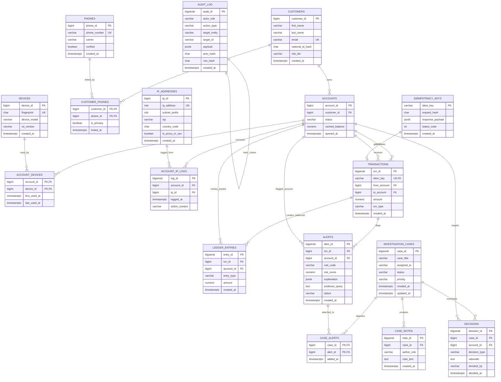

# Entity-Relationship (ER) Model & 3NF Normalization Decomposition

This document formalizes the relational database architecture for the **PostgreSQL-Based Fraud Detection and Temporal Stolen-Money Tracing System**, mapping entities, functional dependencies, normal form decompositions, and lossless join proofs.

---

## 1. Complete Mermaid ER Diagram



---

## 2. Functional Dependencies & 3NF Normalization

### 2.1 Functional Dependencies per Relation

| Relation | Primary Key | Non-Trivial Functional Dependencies (FDs) | Normal Form |
| :--- | :--- | :--- | :--- |
| **`customers`** | `customer_id` | `customer_id → first_name, last_name, email, national_id_hash, risk_tier, created_at`<br>`email → customer_id, ...` (Candidate Key) | **3NF / BCNF** |
| **`accounts`** | `account_id` | `account_id → customer_id, status, cached_balance, opened_at` | **3NF / BCNF** |
| **`devices`** | `device_id` | `device_id → fingerprint, device_model, os_version, created_at`<br>`fingerprint → device_id, ...` (Candidate Key) | **3NF / BCNF** |
| **`phones`** | `phone_id` | `phone_id → phone_number, carrier, verified, created_at`<br>`phone_number → phone_id, ...` | **3NF / BCNF** |
| **`ip_addresses`** | `ip_id` | `ip_id → ip_address, subnet_prefix, isp, country_code, is_proxy_or_vpn, created_at`<br>`ip_address → ip_id, ...` | **3NF / BCNF** |
| **`account_devices`** | `(account_id, device_id)` | `(account_id, device_id) → first_used_at, last_used_at` | **3NF / BCNF** |
| **`customer_phones`** | `(customer_id, phone_id)` | `(customer_id, phone_id) → is_primary, linked_at` | **3NF / BCNF** |
| **`idempotency_keys`**| `idem_key` | `idem_key → request_hash, response_payload, status_code, created_at` | **3NF / BCNF** |
| **`transactions`** | `txn_id` | `txn_id → idem_key, from_account, to_account, amount, txn_type, created_at`<br>`idem_key → txn_id, ...` | **3NF / BCNF** |
| **`ledger_entries`** | `entry_id` | `entry_id → txn_id, account_id, entry_type, amount, created_at` | **3NF / BCNF** |
| **`alerts`** | `alert_id` | `alert_id → txn_id, account_id, rule_code, risk_score, explanation, evidence_query, status, created_at` | **3NF / BCNF** |
| **`investigation_cases`**| `case_id` | `case_id → case_title, assigned_to, status, priority, created_at, updated_at` | **3NF / BCNF** |
| **`decisions`** | `decision_id` | `decision_id → case_id, account_id, decision_type, rationale, decided_by, decided_at` | **3NF / BCNF** |
| **`audit_log`** | `audit_id` | `audit_id → actor_role, action_type, target_entity, target_id, payload, prev_hash, row_hash, created_at` | **3NF / BCNF** |

---

## 3. 3NF Decomposition & Transitive Dependency Prevention

### The Anti-Pattern: Denormalizing Customer into Transactions
If we stored `sender_customer_id` or `sender_status` inside `transactions`:
```text
transactions(txn_id, from_account, to_account, sender_customer_id, sender_status, amount, created_at)
```
The following functional dependency chain would arise:
1. $\text{txn\_id} \rightarrow \text{from\_account}$
2. $\text{from\_account} \rightarrow \text{sender\_customer\_id}, \text{sender\_status}$

This creates a transitive dependency:
$$\text{txn\_id} \xrightarrow{\text{transitive}} \text{sender\_customer\_id}$$
where $\text{sender\_customer\_id}$ is a non-prime attribute dependent on $\text{from\_account}$ (which is not a candidate key of `transactions`). This strictly violates **Third Normal Form (3NF)** and causes update anomalies if a customer changes status or account ownership.

### The 3NF Resolution:
In our decomposed 3NF schema:
- `transactions` retains **only** the direct account foreign keys: `from_account` and `to_account`.
- `accounts` maintains `customer_id` and `status`.
- Queries join `accounts` and `customers` when demographic profiles are required.

---

## 4. Lossless Join Proofs

A decomposition of relation $R$ into $R_1$ and $R_2$ is **lossless** if and only if the common attributes form a superkey of at least one of the decomposed relations:
$$(R_1 \cap R_2) \rightarrow R_1 \quad \text{OR} \quad (R_1 \cap R_2) \rightarrow R_2$$

### Proof 1: Decomposition of Account and Customer
Let $R(\text{account\_id}, \text{status}, \text{balance}, \text{customer\_id}, \text{first\_name}, \text{email})$.
Decomposed into:
- $R_1 = \text{accounts}(\text{account\_id}, \text{status}, \text{balance}, \text{customer\_id})$
- $R_2 = \text{customers}(\text{customer\_id}, \text{first\_name}, \text{email})$

Common attribute:
$$R_1 \cap R_2 = \{\text{customer\_id}\}$$

Since `customer_id` is the Primary Key of `customers`:
$$\{\text{customer\_id}\} \rightarrow R_2$$
Thus, the condition holds. The decomposition is **strictly lossless**.

### Proof 2: Decomposition of Transactions and Ledger Entries
Let $R(\text{txn\_id}, \text{from\_account}, \text{to\_account}, \text{amount}, \text{entry\_id}, \text{entry\_type})$.
Decomposed into:
- $R_1 = \text{transactions}(\text{txn\_id}, \text{from\_account}, \text{to\_account}, \text{amount})$
- $R_2 = \text{ledger\_entries}(\text{entry\_id}, \text{txn\_id}, \text{entry\_type}, \text{amount})$

Common attribute:
$$R_1 \cap R_2 = \{\text{txn\_id}\}$$

Since `txn_id` is the Primary Key of `transactions`:
$$\{\text{txn\_id}\} \rightarrow R_1$$
Thus, the decomposition is **strictly lossless**. No spurious tuples can be generated upon natural join.
